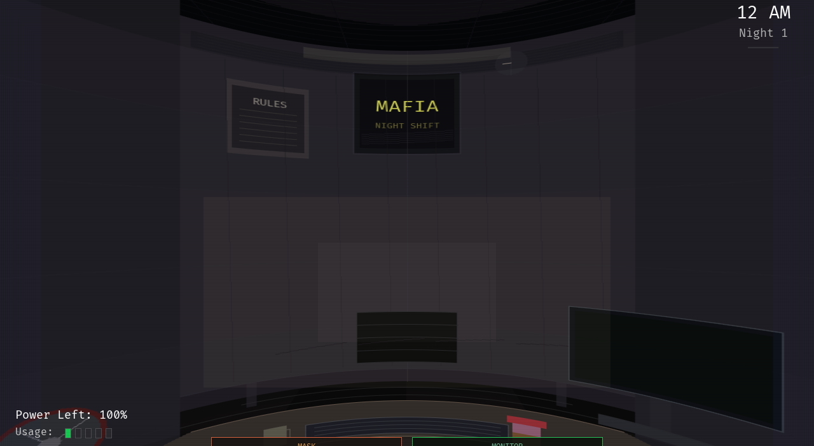
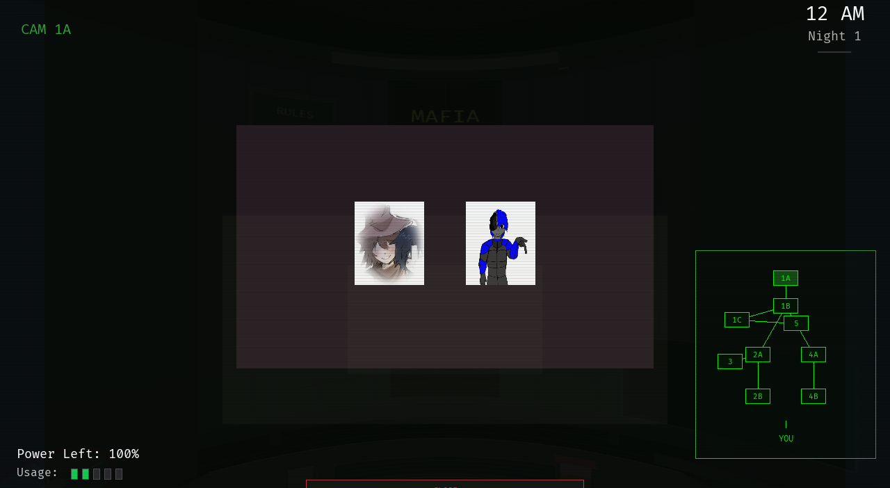

# Five Nights With Friends

[](LICENSE)
[](https://ziglang.org)
[](https://github.com/Renan2010p/neko)

A from-scratch **Zig** rewrite of the *Five Nights With Friends* games, built on
the [Neko](https://github.com/Renan2010p/neko) engine. One repository, two
complete games sharing a single mechanics layer:

| Game | Source | At a glance |
| --- | --- | --- |
| **Classic Edition** | [`fnwf/classic/`](fnwf/classic) | The original office, rebuilt from the C++ game — cylindrical panorama, 9 cameras, doors, lights, the mask, power, story mode and achievements. |
| **Five Nights With Friends 1** | [`fnwf/fnwf1/`](fnwf/fnwf1) | An original take on the FNAF 1 formula — 11 cameras and a map, the FNAF 1 AI model, nights 1–6, a Custom Night and Cedro's nightly calls. |

Every game renders through **SDL3**, ships its own assets, and can drop in GLSL
shaders **without touching the engine**.

## Screenshots

**Classic Edition** — the office and the security monitor:

| Office | Security monitor |
|--------|------------------|
|  |  |

## Contents

- [Screenshots](#screenshots)
- [Requirements](#requirements)
- [Build & run](#build--run)
- [Controls](#controls)
- [The games](#the-games)
- [Custom shaders](#custom-shaders)
- [Project layout](#project-layout)
- [Credits](#credits)
- [License](#license)

## Requirements

- **Zig 0.17.0**
- **SDL3** with `SDL3_image`, `SDL3_ttf` and `SDL3_mixer` (development files)

```sh
# Void Linux
sudo xbps-install -S SDL3-devel SDL3_image-devel SDL3_ttf-devel SDL3_mixer-devel

# Debian / Ubuntu
sudo apt install libsdl3-dev libsdl3-image-dev libsdl3-ttf-dev libsdl3-mixer-dev
```

Neko also provides a legacy SDL2 backend; the games default to **SDL3**, chosen
in [`neko/config.zig`](neko/config.zig).

## Build & run

```sh
zig build                       # build the Classic Edition (default)
zig build run                   # build and run it
zig build -Dgame=fnwf1          # build Five Nights With Friends 1
zig build -Dgame=fnwf1 run      # build and run it
```

The engine is a **remote dependency**, pinned in
[`build.zig.zon`](build.zig.zon):

```zig
.neko = .{
    .url = "https://github.com/Renan2010p/neko/archive/<commit>.tar.gz",
    .hash = "neko-0.1.0-…",
},
```

The first build downloads it into Zig's cache — no local `../neko` checkout is
needed. To follow a newer engine commit, point `.url` at that commit's tarball
and refresh `.hash` (`zig fetch <url>` prints it).

## Controls

### Classic Edition

| Input | Action |
| --- | --- |
| Mouse | Pan the office; click door, light, camera and mask buttons |
| <kbd>Space</kbd> / <kbd>Tab</kbd> | Toggle the camera monitor |
| <kbd>1</kbd>–<kbd>9</kbd> | Select a camera |
| <kbd>Q</kbd> / <kbd>E</kbd> | Left / right door |
| <kbd>A</kbd> / <kbd>D</kbd> | Left / right light |
| <kbd>L</kbd> | Vent light |
| <kbd>X</kbd> | Put on / take off the mask (monitor closed) |
| <kbd>Esc</kbd> | Back to the menu |

### Five Nights With Friends 1

| Input | Action |
| --- | --- |
| Mouse | Pan the office; click buttons and the camera map |
| <kbd>Space</kbd> | Toggle the monitor |
| <kbd>1</kbd>–<kbd>9</kbd>, <kbd>K</kbd>, <kbd>L</kbd> | Select a camera |
| <kbd>Q</kbd> / <kbd>A</kbd> | Left door |
| <kbd>E</kbd> / <kbd>D</kbd> | Right door |
| <kbd>Z</kbd> / <kbd>C</kbd> | Left / right light |
| <kbd>F</kbd> | Cycle the office view |
| <kbd>Esc</kbd> | Back to the menu |

Both games expose **Neko Options** from the main menu, where the render driver
can be switched at runtime — **OpenGL**, **OpenGL ES**, **Vulkan** or
**software** (`sdl3` backend).

## The games

### Classic Edition · `fnwf/classic`

A faithful rebuild of the original game, including:

- **Office** rendered as a **cylindrical panorama**, panned by moving the mouse,
  with door and light buttons placed inside the panorama.
- **Security system** with nine cameras and a clickable map.
- **Doors, lights and a vent light**, all draining a shared **power** meter.
- **Animatronics** driven by per-night AI, plus the **mask** mechanic.
- A full state flow: splash, warning, loading, story, night transitions,
  12 AM→6 AM, 6 AM, game over, the death newspaper, the paycheck and a victory
  screen.
- **Extras**: an arcade, a Custom Night, achievements (`conquistas`) and
  **localization** (`i18n`).

### Five Nights With Friends 1 · `fnwf/fnwf1`

An original entry in the series:

- **Office** with two hallways, a door and a light per side, panned with the
  mouse.
- **Security monitor** with 11 cameras — Show Stage, Dining, Pirate Cove, West
  and East Halls, Supply, Backstage, Kitchen, Restrooms — and a map.
- **Power** meter with usage bars; doors, lights and the monitor all drain it.
- **FNAF 1 AI model**: movement opportunities every few seconds, a 1–20 roll
  against the AI level, ramping AI at 2/3/4 AM, Cedro (Freddy) who only moves
  when unwatched, and Sonk (Foxy) who charges the west hall when Pirate Cove is
  ignored.
- **Five nights**, plus Night 6 and a Custom Night: a 12 AM→6 AM clock, the 6 AM
  celebration, jumpscares, the death newspaper, the paycheck and a victory paper.
- **Story**: Cedro, the guard before you, calls every night — a Portuguese take
  on the Phone Guy that leads into the pizzeria's secret.

**Cast:** **Eser** (left hall), **Alice** (right hall), **Sonk** (Pirate Cove)
and **Cedro** (the boss).

## Custom shaders

The office panorama is composited with a shader when the backend supports one. A
game supplies its own — **from its own package** — in priority order:

1. **Shader files in the game's assets** — edit
   `fnwf/classic/assets/shaders/office.{vert,frag}` (or the `fnwf1` copy). The
   game loads them with `neko.shader.load_files`.
2. The engine's built-in `cylinder` shader (`neko.shader.load_builtin`).
3. The per-column CPU mesh, which always works (including the SDL2 backend).

Adding an effect means dropping GLSL into your game — no `neko` changes:

```zig
const prog = neko.shader.load_files(
    neko.allocator(),
    "fnwf/fnwf1/assets/shaders",
    "post.vert",
    "post.frag",
);
if (prog) |p| p.draw(scene_tex, .{ 0, 0, 0, 0 });
```

The `SDL_Renderer` API itself does not run custom shaders, so the games fall
back to the CPU mesh unless a backend with a shader path is selected.

## Project layout

```
build.zig / build.zig.zon   the game package (depends on the neko package)
neko/config.zig             engine config for this game (backend choice)
screenshots/                README captures (Classic Edition)
fnwf/
  common/                   mechanics shared by every FNWF game
  classic/                  the Classic Edition
    config/                 constants  colors  settings  cheats
    world/                  locations  game_data
    i18n/                   localization
    states/                 splash, warning, menu, story, gameplay, …
    systems/                office, cameras, doors, power, AI, jumpscare
    assets/                 sprites, audio, font, shaders
  fnwf1/                    Five Nights With Friends 1
    main.zig                entry point + state graph
    office.zig  cameras.zig  power.zig  animatronics.zig
    menu.zig  call.zig  gameplay.zig  six_am.zig  gameover.zig
    custom_night.zig  paycheck.zig  newspaper.zig  options.zig  extras.zig
    save.zig  config.zig  world.zig
    assets/                 sprites, audio, font, shaders
```

## Credits

Created and directed by **Renan Lucas Vieira Hilário**, with AI assistance from
**DeepSeek V4.1 Flash**.

Animatronics: **Cedro**, **Eser**, **Alice** and **Sonk**.

## License

GNU General Public License v3.0 or later (**GPL-3.0-or-later**). See
[`LICENSE`](LICENSE).

Copyright (C) 2026 Renan Lucas Vieira Hilário.
